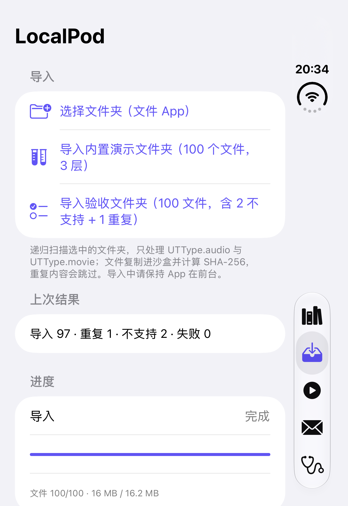
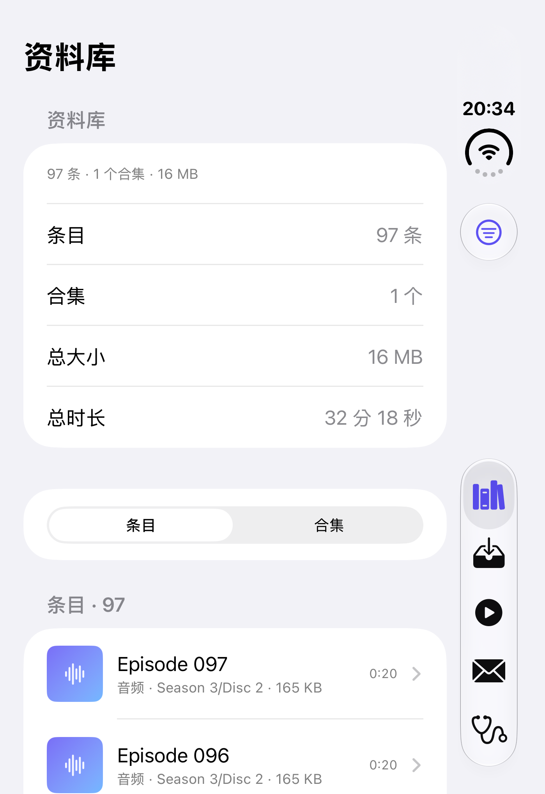
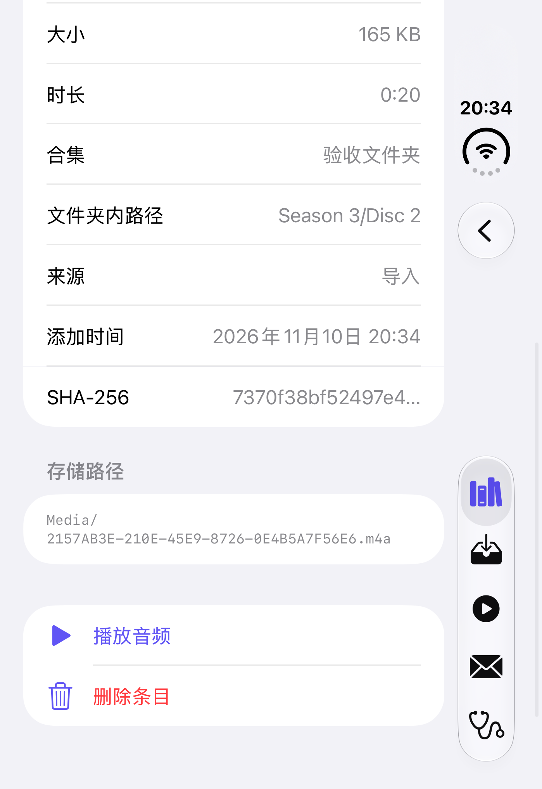
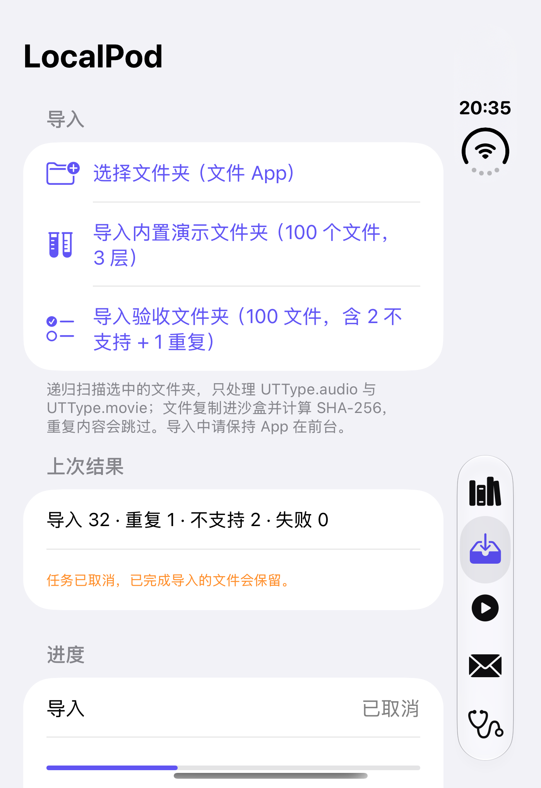
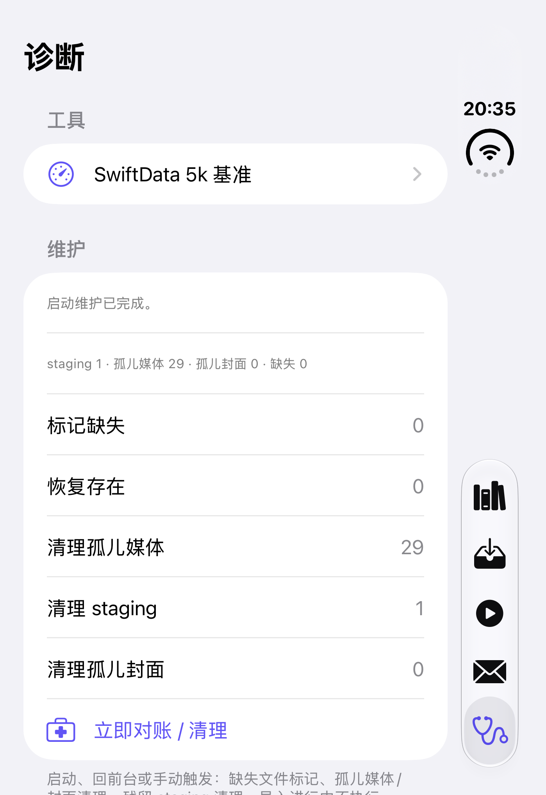
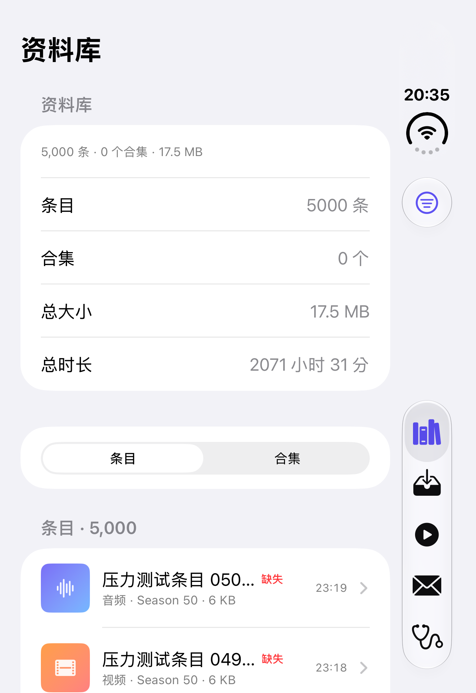

# LocalPod M1 实施与验证报告

> 日期：2026-11-10
> 工程：`/Users/xlf/Dev/code/localpod`
> 结论：**M1「导入与资料库」代码完成，模拟器与自动化验收通过；真实文件夹选择器、真实 iCloud 下载、真机性能仍待真机验证，未计为已通过。**
> 计划基线：`PLAN.md` 5.3

## 1. 环境

| 项 | 值 |
| --- | --- |
| macOS | 27.0.1 (26A434) |
| Xcode | 27.1 (27A9275) |
| Swift | 6.4（Swift 6 语言模式） |
| iOS SDK | 27.1 |
| 模拟器 | iOS 27.1 · iPhone Duo（UDID `3055696C-BC73-4190-A3F7-EE0AC55F1EE6`） |
| 部署目标 | iOS 17.0，仅 iPhone |
| 签名 | 模拟器 ad-hoc；真机免费账号见 `docs/M0-DEVICE-CHECKLIST.md` |

> 本机只有 iOS 27.1 模拟器运行时，未在 iOS 17 模拟器上执行。iOS 17 真机行为仍在真机待办中。

## 2. M1 交付

| 交付 | 状态 | 说明 |
| --- | --- | --- |
| FolderScanner：过滤、深度/数量上限、自然排序、iCloud 状态 | 完成 | 仅 `UTType.audio` / `UTType.movie`；跳过隐藏文件、符号链接、包；报告不支持文件；iCloud 未下载文件保留给引擎处理 |
| ImportEngine：staging、分块复制、SHA-256、取消、清理、报告 | 完成 | 1 MB 分块 + CryptoKit SHA-256；每会话独立 staging；成功后原子移动到 `Application Support/Media`；失败/取消清理 staging，保留已完成条目 |
| MediaProbe：时长、音/视频轨、元数据、封面/缩略图 | 完成 | AVFoundation 读取 duration/tracks/common metadata；视频生成 JPEG 缩略图；音频提取内嵌封面并转 JPEG |
| SwiftData 模型 + 批量写入 + 启动对账 + 缺失重链 | 完成 | Schema V2（MediaItem / MediaCollection / ImportSession）；V1→V2 lightweight migration 演练通过；每 100 条批量保存；启动清理 staging、孤儿媒体/封面，标记/恢复缺失；同指纹重链 |
| 资料库/合集/条目详情/搜索/筛选/排序/删除/存储占用 | 完成 | 条目/合集双视图、搜索框、筛选（全部/音频/视频/缺失）、排序（最近/标题/大小/时长）、详情、播放、删除、总大小/总时长 |
| 导入向导 + 进度 + 报告 | 完成 | 文件夹选择、演示/验收文件夹、进度/阶段/当前文件、取消、分类结果、JSON 报告、ImportSession 记录 |
| 去重与重复导入 | 完成 | SHA-256 内容去重；重复跳过并计数；重复导入不重复建合集 |
| 删除资源 | 完成 | 删除 SwiftData 记录 + 媒体文件 + 封面文件，资料库统计同步更新 |

主要新增/修改文件：

- `LocalPodKit/Sources/LocalPodKit/Persistence/LocalPodSchema.swift`：Schema V2 + migration plan。
- `LocalPodKit/Sources/LocalPodKit/Import/`：`FolderScanner.swift`、`ChunkedFileCopier.swift`、`CloudDownloader.swift`、`ImportEngine.swift`、`ImportModels.swift`、`FolderImportService.swift`、`MediaStorage.swift`、`DemoFolderFactory.swift`。
- `LocalPodKit/Sources/LocalPodKit/Media/MediaProbe.swift`：真实 AVFoundation probe。
- `LocalPodKit/Sources/LocalPodKit/Library/LibraryService.swift`：DB 提交、删除、对账、统计。
- `LocalPod/Features/Library/LibraryView.swift`：资料库 UI。
- `LocalPod/Spikes/Import/ImportView.swift`、`InboxView.swift`、`DiagnosticsView.swift`：导入/报告/维护 UI。
- `LocalPodUITests/M1UITests.swift`：M1 端到端 UI 测试。

## 3. 验收标准对照

| # | PLAN 5.3 验收项 | 结果 | 证据 |
| --- | --- | --- | --- |
| 1 | 3 层 100 文件（2 不支持 + 1 重复）：进度准确、报告分类正确 | **通过（模拟器）** | `M1UITests.testAcceptanceImportReportDedupAndLibrary`：97 导入 / 1 重复 / 2 不支持 / 0 失败；`ImportEngineTests` 覆盖扫描/去重/不支持分类 |
| 2 | 导入中取消：已完成项保留、staging 清理、无半条记录 | **通过** | `M1UITests.testCancelDuringSlowImport`；`ImportEngineTests.testCancellationKeepsCompletedFilesAndCleansStaging` |
| 3 | 导入中强杀：重启无脏数据、staging 可清理 | **通过（模拟器）** | `M1UITests.testForceKillLeavesNoDirtyLibraryAndMaintenanceCleansStaging`：强杀后资料库 0 条，启动维护清理残留 staging |
| 4 | 重复导入：新增 0、跳过 N、不重复建合集 | **通过** | UI 测试第二次导入 0 / 98 / 2；资料库仍为 1 个合集；`LibraryServiceTests` 去重与合集归一化 |
| 5 | iCloud 未下载：下载进度、断网错误、重试成功 | **部分自动化，真实 iCloud 待真机** | `ICloudDownloader` 本地文件 no-op 已测；`ImportEngineTests.testCloudDownloadRetriesThenImports` / `testCloudDownloadFailureIsReportedAfterRetries` 覆盖重试与失败分类；真实 iCloud provider/断网未在模拟器验证 |
| 6 | 元数据/时长/类型、视频缩略图、音频封面或占位 | **通过** | `MediaProbeTests` 真实 M4A/MP4：时长、音视频轨、标题、视频 JPEG 缩略图；UI 无封面时显示渐变占位图 |
| 7 | 删除条目：文件与记录都消失、存储数字更新 | **通过** | UI 测试 97 → 96 条；`LibraryServiceTests` 校验媒体文件与封面被删除；存储数字来自资料库总大小 |
| 8 | 模拟重装/容器路径变化后相对路径可解析 | **通过（单元测试模拟）** | `MediaStorageTests` + `LibraryServiceTests` 容器迁移后仍按相对路径定位媒体；真机重装见 M0 真机清单 |
| 9 | 5000 文件导入内存 < 200 MB，主界面不明显卡顿 | **通过（本机/模拟器）** | `FiveThousandImportTests`：峰值增量 **100.3 MB**，5000 条全部导入、0 失败；`M1UITests.testLibraryFiveThousandItemsScroll` 通过 |

> 第 5 项没有勾选为“通过”：下载重试/失败分类是可自动化的部分，但真实 iCloud 未下载文件的进度、断网与恢复只能在真机 + 真实 iCloud Drive 上确认。

## 4. 自动化结果

### 4.1 LocalPodKit 单元/集成测试

命令：

```bash
cd LocalPodKit
swift test
```

结果：

```text
Executed 32 tests, with 0 failures (0 unexpected) in 6.162 seconds
5000-file import: 100.3 MB peak delta, 100.3 MB final delta
SwiftData benchmark (macOS, in-memory): insert 0.390s, count+page 0.002s
```

覆盖重点：

- 扫描：3 层目录、自然排序、深度/数量上限、单文件、UTType 过滤、不支持文件、iCloud 状态。
- 复制：分块复制、SHA-256、取消、重名、路径穿越、staging 清理。
- 去重/重链：相同内容跳过、缺失指纹重链。
- Probe：真实 M4A/MP4 时长、轨道、标题、视频缩略图；损坏文件失败；本地 iCloud 文件 no-op。
- 存储：路径安全、容器迁移后相对路径。
- iCloud 逻辑：下载失败重试后成功；重试耗尽后报告 `cloudDownloadFailed` 且无残留文件。
- 持久化：V1 → V2 lightweight migration；5000 条批量插入/查询。
- 5000 文件导入：`resident_size` 峰值增量 100.3 MB（阈值 200 MB），staging 为空。
- 资料库：导入提交、重复导入、合集归一化、删除媒体+封面、部署对账（缺失标记/恢复/孤儿清理/staging 清理）。

### 4.2 UI 测试

```text
M0UITests: Executed 5 tests, with 0 failures in 65.9 seconds
M1UITests: Executed 5 tests, with 0 failures in 87.4 seconds
```

M1 用例：

| 用例 | 验证内容 |
| --- | --- |
| `testAcceptanceImportReportDedupAndLibrary` | 验收文件夹 97/1/2；二次导入 0/98/2；合集仍为 1；资料库条目详情 |
| `testCancelDuringSlowImport` | 慢速复制中取消；显示取消文案；资料库未写入全部 97 条 |
| `testForceKillLeavesNoDirtyLibraryAndMaintenanceCleansStaging` | 复制中强杀；重启维护清理 staging；资料库 0 条 |
| `testDeleteItemUpdatesLibraryAndStorage` | 详情删除条目；资料库 97 → 96 条 |
| `testLibraryFiveThousandItemsScroll` | 5000 条资料库渲染与滚动 |

M0 回归：导入 100 文件、音频播放、收件箱、SwiftData 5k 基准全部通过。M0 复合用例已拆成“导入”和“播放”两个独立用例，避免互相拖累。（H.264/HEVC UI 用例已在 M3 音频-only 返工中删除。）

### 4.3 截图

| 截图 | 内容 |
| --- | --- |
|  | 验收导入分类结果与 100/100 进度 |
|  | 97 条、1 个合集、存储/时长统计 |
|  | 元数据、时长、集合、来源、SHA-256 前缀 |
|  | 取消后保留已完成条目 |
|  | 启动对账清理 staging |
|  | 删除后 96 条 |
|  | 5000 条资料库列表 |

## 5. 关键实现说明与修正

- **staging 文件保留真实扩展名**：AVFoundation 依据路径扩展名推断容器格式。初版用 `.part` 命名 staging 文件，导致真机/模拟器上所有 probe 失败（报告 98 条 `probeFailed`）。已改为 `<UUID>.<原扩展名>`，并新增真实 probe 的回归测试。崩溃残留仍由每会话 staging 目录 + 启动对账清理。
- **去重与重链**：导入前从 SwiftData 读取已有指纹；SHA-256 相同则跳过；缺失条目的指纹单独作为重链集合，重新导入同内容时恢复原记录。
- **原子提交**：复制/哈希/探测全部在 staging 完成，成功后 `moveItem` 到 `Media/<UUID>.<ext>`；失败或取消不留下半条记录。
- **启动对账**：启动和回前台执行；缺失文件标记、恢复存在项、清理孤儿媒体/封面、清理残留 staging。维护统计在本次 App 会话内累计，后续空跑不会覆盖先前的清理结果。
- **V1 → V2 迁移**：M0 的 `MediaItem` 快照保留在 `LocalPodSchemaV1`，V2 新增合集、导入会话、指纹、相对路径等字段；lightweight migration 演练测试通过。
- **报告**：每次导入写 JSON 到 `Application Support/ImportReports`，并在 SwiftData 记录 `ImportSession`；UI 可查看分类报告。
- **删除**：删除数据库记录、媒体文件与封面；资料库统计由 SwiftData 查询实时计算。

## 6. 待真机验证（未计为通过）

- [ ] 真实 `UIDocumentPickerViewController` 选择文件 App / iCloud Drive 文件夹，确认 security-scoped 访问、递归扫描、导入结果。
- [ ] 真实 iCloud 未下载文件：下载中进度、断网错误提示、联网后重试成功。
- [ ] 最老支持 iPhone（iOS 17）：3 层 100 文件导入耗时/内存；5000 文件导入峰值内存 < 200 MB；资料库 5000 条滚动是否明显卡顿。
- [ ] 真机重装/覆盖安装后，资料库记录与 `Application Support/Media` 相对路径仍可解析。
- [ ] 人工确认资料库搜索框、筛选/排序菜单在真实设备上的交互（本模拟器运行时的搜索控件未暴露给 XCUITest，自动化未覆盖）。
- [ ] M0 真机项（免费账号签名/7 天过期、锁屏/控制中心）继续见 `docs/M0-DEVICE-CHECKLIST.md`。

## 7. 已知限制

- iCloud 下载进度为不确定进度（系统未提供稳定的百分比 API）；下载超时默认 600 秒，失败会进入报告并继续处理其他文件。
- 导入期间需要保持 App 前台；没有后台导入。
- 仅支持 AVFoundation 可播放的音频/视频容器；不支持 VLCKit/MKV/AVI/OGG（按既定决策）。
- 音频封面仅提取内嵌 artwork；无内嵌封面时显示占位图，不做在线刮削。
- 未做 Share Extension、App Group、CarPlay、StoreKit（按既定决策）。
- UI 自动化使用 DEBUG 启动参数与内置文件夹，不等同于真实文件夹选择器。

## 8. 复现命令

```bash
cd /Users/xlf/Dev/code/localpod

# 核心测试
cd LocalPodKit && swift test && cd ..

# 生成工程（修改 project.yml 或新增文件后）
xcodegen generate

# 模拟器 UI 测试（替换为本机 UDID）
xcodebuild test -project LocalPod.xcodeproj -scheme LocalPod \
  -destination 'platform=iOS Simulator,id=<SIMULATOR_UDID>'
```

> 本机多次连续运行 UI 测试时曾出现 `xcodebuild` 在启动测试前挂起（模拟器 testmanager 状态问题）；重启模拟器后可稳定复现上述结果。
