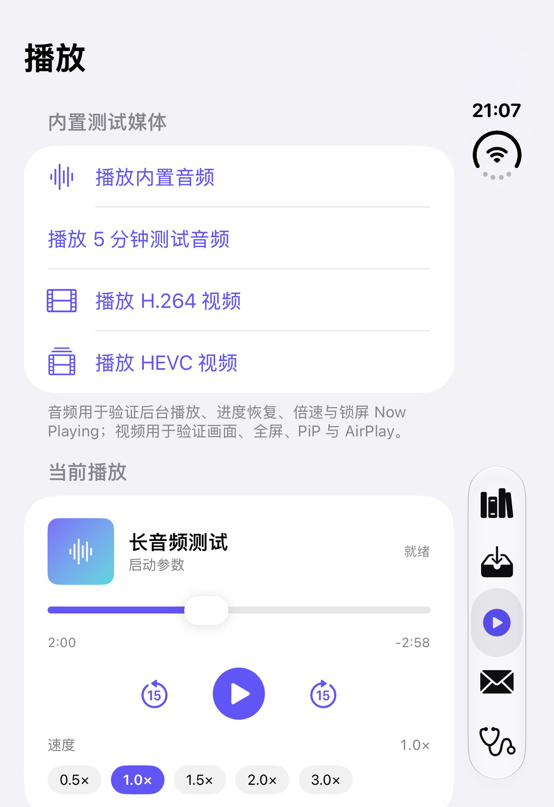
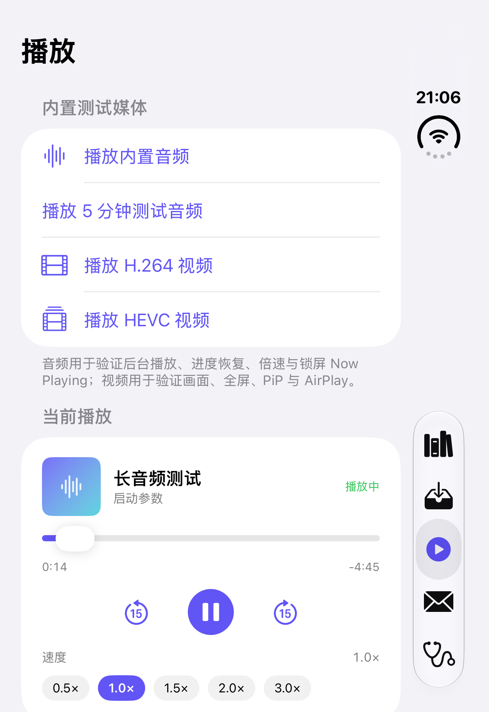

# LocalPod M2 实施与验证报告

> 日期：2026-11-10（M3 音频-only 返工后更新）
> 工程：`/Users/xlf/Dev/code/localpod`
> 结论：**M2「播放核心」代码完成，进度恢复、倍速、后台音频与中断策略在模拟器/自动化中通过；锁屏/控制中心、真实中断/路由、AirPlay 音频、2 小时长播内存仍待真机验证，未计为已通过。**
> 计划基线：`PLAN.md` 5.4
>
> **音频-only 返工说明**：M2 完成时曾实现 AVPlayerViewController 全屏视频、旋转与 PiP。随后产品决策明确 LocalPod 只播放音频、不显示画面；M3 已删除 `VideoPlayerScreen`、PiP、横屏声明、视频后台暂停策略及相关测试。视频文件仍可导入并播放音轨。本文中相关条目保留历史记录并标注“已移除”，当前能力以 M3 代码为准。

## 1. 环境

| 项 | 值 |
| --- | --- |
| macOS | 27.0.1 (26A434) |
| Xcode | 27.1 (27A9275) |
| Swift | 6.4（Swift 6 语言模式） |
| iOS SDK | 27.1 |
| 模拟器 | iOS 27.1 · iPhone Duo（UDID `3055696C-BC73-4190-A3F7-EE0AC55F1EE6`） |
| 部署目标 | iOS 17.0，仅 iPhone |
| 签名 | 模拟器 ad-hoc；真机免费账号见 `docs/M0-DEVICE-CHECKLIST.md` |

> 本机只有 iOS 27.1 的 iPhone Duo 模拟器，没有 iOS 17 运行时。iOS 17 真机行为仍在真机待办中；音频-only 应用只声明竖屏。

## 2. M2 交付

| 交付 | 状态 | 说明 |
| --- | --- | --- |
| PlaybackController + 状态机 + 错误恢复 | 完成 | `idle / preparing / ready / playing / paused / buffering / interrupted / ended / failed`；加载/播放/暂停/seek/倍速/重试；失败可手动重试，播放键在失败后也会重建并续播；媒体服务重置后按原位置重建；所有 item 回调带 ID 校验，切歌 100 次无串台 |
| AudioSession / Now Playing / 远程命令 | 完成 | `.playback` + `.allowAirPlay`，统一 `.spokenAudio`（视频文件也只播音轨）；锁屏信息含标题、合集、时长、已播时间、倍速、真实封面或渐变占位图；播放/暂停/切换/±15s/拖动命令；媒体服务重置监听 |
| 中断 / 路由 | 完成 | 打断开始暂停并记录原状态；结束后按 `shouldResume` 恢复；旧输出设备（拔耳机）暂停；真实系统事件未在模拟器自动化 |
| 进度持久化 / 恢复 / 完成阈值 | 完成 | 新增 SwiftData V3 `PlaybackState` 独立表；播放中约每秒保存，暂停/seek/切歌/后台/结束强制保存；恢复规则 `3 < position < duration-30`；完成规则 ≥95%，或时长 >60s 且剩余 ≤30s；播完不自动续播，手动重播从 0 开始 |
| 倍速 + timeDomain | 完成 | 播放器提供 0.5/1.0/1.5/2.0/3.0× 胶囊；策略层另有 0.8/1.2/1.8/2.5 预设；每个 `AVPlayerItem.audioTimePitchAlgorithm = .timeDomain`；仅在播放中改变 `player.rate` |
| 音频播放器 UI | 完成（M3 已扩展） | 封面、标题、状态、错误+重试、进度条、当前/剩余时间、上一首/下一首、可配置 ±间隔、播放暂停、倍速；M3 增加队列与睡眠定时；滑块拖动只在松手时 seek/保存，避免每帧写数据库 |
| 视频 AVPlayerViewController | **已移除** | M2 曾实现全屏 cover、旋转、PiP、AirPlay 与后台暂停；按“仅音频”决策，M3 删除 `VideoPlayerScreen`、PiP、横屏声明与相关 UI 测试 |
| 视频后台策略 | **已移除** | 不再有视频画面与 PiP；所有文件统一按音频后台继续，仅保留进度强制保存 |
| 测试与文档 | 完成 | 当前累计 94 个核心测试、M2 UI 5 个、M0 4 个 + M1 5 个回归；本报告按音频-only 更新，M3 结果见 `docs/M3-REPORT.md` |

主要新增/修改文件：

- `LocalPodKit/Sources/LocalPodKit/Persistence/LocalPodSchema.swift`：Schema V3 + `PlaybackState` + V2→V3 迁移。
- `LocalPodKit/Sources/LocalPodKit/Playback/PlaybackController.swift`：控制器与状态机重写。
- `LocalPodKit/Sources/LocalPodKit/Playback/PlaybackPolicy.swift`：恢复/完成/倍速/打断策略。
- `LocalPodKit/Sources/LocalPodKit/Playback/PlaybackProgressStore.swift`：SwiftData 进度读写。
- `LocalPodKit/Sources/LocalPodKit/Playback/PlaybackItem.swift`：增加 `libraryItemID`、`artworkURL`。
- `LocalPodKit/Sources/LocalPodKit/Library/LibraryService.swift`：删除条目时级联删除进度行。
- `LocalPod/Spikes/Playback/PlaybackView.swift`：播放器 UI、倍速胶囊、可访问性标识（M3 扩展队列/睡眠定时）。
- `LocalPod/Spikes/Playback/VideoPlayerScreen.swift`：已删除（M3 音频-only 决策）。
- `LocalPod/App/RootView.swift`：进度存储挂载、前后台策略、M2 调试启动参数。
- `LocalPod/Features/Library/LibraryView.swift`：资料库播放传递条目 ID/封面。
- `project.yml` / `LocalPod/Info.plist`：`UIBackgroundModes` 仅保留 `audio`；横屏声明已移除（M3）。
- 测试：`PlaybackPolicyTests`、`PlaybackProgressStoreTests`、`PlaybackControllerTests`、`SchemaMigrationTests`、`LibraryServiceTests`、`LocalPodUITests/M2UITests.swift`。
- 资源：`demo-long-audio.m4a`（约 298 秒 TTS 中文语音，用于恢复/完成/后台测试）。

## 3. 验收标准对照

| # | PLAN 5.4 验收项 | 结果 | 证据 |
| --- | --- | --- | --- |
| 1 | 锁屏后音频继续；锁屏显示标题/封面/进度；控制中心播放/暂停/±15s/拖动生效 | **部分自动化，真机待验** | `testAudioAdvancesWhileAppIsInBackground`：按 Home 后台 3 秒后回前台，播放时间继续前进 ≥2 秒；`testNowPlayingMetadataAndRemoteCommands`：标题/合集/时长/速率写入 Now Playing、远程命令启用、±15s 间隔为 15；锁屏/控制中心实际 UI 与拖动未在模拟器确认 |
| 2 | 强退后重开，进度恢复误差 ≤ 2 秒；已播完不自动续播 | **通过（模拟器）** | `testResumeAfterRelaunchWithinTwoSeconds`：跳到 2:00 后强退，重开回到 2:00（±2s）；`testForceQuitWhilePlayingResumesWithinTwoSeconds`：播放中强退，恢复误差 ≤2s；`testFinishedItemDoesNotAutoResume`：播放结束重开为 0:00；核心测试另覆盖完成阈值 |
| 3 | 0.5/1.0/1.5/2.0/3.0x 可用，人声不变调 | **部分自动化，听感待真机** | `testSpeedPresetsPlayPauseAndSkip` 依次点击 0.5/1.0/1.5/2.0/3.0× 并校验标签；`testRatePresetsAndPitchCorrection` 校验限幅与 `audioTimePitchAlgorithm == .timeDomain`；实际人声不变调无法由自动化听辨 |
| 4 | 视频有画面；全屏/旋转/PiP/AirPlay 正常；后台默认暂停，回前台恢复 | **已取消（音频-only 决策）** | 该验收项在 M3 被产品决策取代：视频文件只播放音轨，不显示画面。`testVideoFilePlaysAudioTrackWithoutVideoSurface` 验证视频文件加载后无视频渲染且可播放；全屏/旋转/PiP/视频后台暂停测试与代码均已删除 |
| 5 | 拔耳机暂停；来电/闹钟打断后按 shouldResume 恢复 | **策略已测，系统事件待真机** | `PlaybackPolicyTests.testInterruptionResumeDecision`；控制器已监听 `interruptionNotification` / `routeChangeNotification`；模拟器无法可靠注入真实来电/闹钟/拔耳机事件 |
| 6 | 2 小时长音频播放内存稳定，无泄漏；切歌 100 次无崩溃 | **部分通过** | `testOneHundredItemSwitchesDoNotCrash`：100 次加载/切换通过；2 小时连续播放内存/泄漏需真机长跑，未在本会话执行 |

> 第 1、3、4、5、6 项未在 PLAN 中勾选为通过；自动化覆盖的部分已列出，其余列入第 6 节真机清单。

## 4. 自动化结果

### 4.1 LocalPodKit 单元/集成测试

命令：

```bash
cd LocalPodKit
swift test
```

结果（M2 完成时点）：

```text
Executed 60 tests, with 0 failures (0 unexpected) in 8.031 seconds
5000-file import: 100.3 MB peak delta, 100.3 MB final delta
SwiftData benchmark (macOS, in-memory): insert 0.383s, count+page 0.002s
```

M3 完成后当前累计为 **94 tests, 0 failures**（见 `docs/M3-REPORT.md`）。

M2 新增覆盖：

- `PlaybackPolicyTests`（9）：必需倍速与限幅、95%/30 秒完成阈值、短音频不吃“剩余 30 秒”规则、恢复窗口、中断恢复决策。
- `PlaybackProgressStoreTests`（9）：新条目无进度、播放计数、保存/恢复往返、完成不恢复且重播归零、位置限幅、非法值、回退时长、删除、多条独立。
- `PlaybackControllerTests`（9）：真实 5 分钟 M4A 加载时长、播放/暂停/seek/skip、5 档倍速与 `timeDomain`、播放中持久化并在新控制器恢复 ≤2s、完成不自动续播、后台音频继续、视频文件仅音轨且无视频渲染、Now Playing/远程命令、100 次切歌。
- `SchemaMigrationTests`（3）：V1→V3、V2→V3 lightweight migration，迁移后 `PlaybackState` 可写；M3 增加 V3→V4。
- `LibraryServiceTests`（9）：删除资料库条目时级联删除进度行。

### 4.2 UI 测试

```text
M0UITests: 4 tests, 0 failures
M1UITests: 5 tests, 0 failures
M2UITests: 5 tests, 0 failures
```

M2 用例：

| 用例 | 验证内容 |
| --- | --- |
| `testSpeedPresetsPlayPauseAndSkip` | 长音频加载、播放、0.5/1.0/1.5/2.0/3.0× 逐档切换、时间前进、暂停 |
| `testResumeAfterRelaunchWithinTwoSeconds` | 跳到 2:00 → 强退 → 重开恢复到 2:00 ±2s |
| `testForceQuitWhilePlayingResumesWithinTwoSeconds` | 播放中强退 → 重开恢复位置误差 ≤2s |
| `testFinishedItemDoesNotAutoResume` | 播放到结束 → 重开停在 0:00，不自动续播 |
| `testAudioAdvancesWhileAppIsInBackground` | 音频播放中按 Home 3 秒，回前台后时间继续前进 |

M0/M1 回归全部通过（导入 100 文件、音频启动、收件箱、5k 基准、验收导入/取消/强杀/删除/5k 列表）。原 `testVideoFullScreenPresentAndDismiss` 与 M0 H.264/HEVC 用例已按音频-only 决策删除。

### 4.3 截图

| 截图 | 内容 |
| --- | --- |
|  | 播放器卡：封面、进度、±15s、暂停状态、5 档倍速胶囊与 1.0× |
|  | 强退重开后停在 2:00，状态“就绪”，不自动播放 |
|  | 播完后重开为 0:00，不自动续播 |
|  | 音频后台 3 秒后回到前台，时间继续前进 |

> `screenshots/M2-video-fullscreen.png` 为历史截图；全屏视频能力已在 M3 移除，不再作为当前交付。

## 5. 关键实现说明与修正

- **进度表与资料库解耦**：`PlaybackState` 放在独立的 V3 表，以 `itemID` 唯一标识；每秒进度写入不会让 `MediaItem` 查询/资料库列表失效。V2 实体在 V3 中复用，V1→V3 与 V2→V3 均有真实 lightweight migration 测试。
- **恢复误差**：每 0.5s 时间回调中按墙钟节流约 1 秒写一次；暂停、seek、切歌、进后台、播放结束/失败再强制写一次。UI 测试覆盖“暂停后跳转强退”和“播放中强退”两种路径。
- **完成阈值**：`position >= 95%`，或 `duration > 60s && duration-position <= 30s`。短音频（如 20 秒 demo）不受“剩余 30 秒”影响，避免一加载就被判完成。
- **状态机与切歌竞态**：KVO/通知回调都携带 `itemID` 并与当前 item 比对，旧 item 的延迟回调不会改新 item 的状态；100 次快速切换测试通过。
- **后台策略（音频-only）**：`scenePhase` 变化时音频继续播放，控制器只强制保存一次进度；原“视频后台暂停 / PiP 例外”逻辑已随视频画面能力移除。
- **Now Playing**：只在状态变化时更新（不是每 0.5s），系统按 elapsed + rate 自行推进锁屏进度；封面优先读取导入时生成的 JPEG，缺失时使用渐变占位图。远程命令覆盖播放/暂停/切换/±15s/拖动。
- **PiP（已移除）**：M2 曾开启 PiP 并声明 `picture-in-picture` 后台模式；M3 已删除相关代码、Info.plist 条目与测试。
- **删除级联**：`LibraryService.delete` 在删除媒体记录前按 `itemID` 删除进度行，避免孤立进度。
- **测试素材**：新增 298 秒中文 TTS M4A，满足恢复窗口（>33 秒）与完成阈值（>60 秒）测试需要；旧 20 秒 demo 继续用于快速加载/切换。
- **模拟器限制**：本机只有 iPhone Duo 模拟器；仅音频应用只声明竖屏，无需旋转验证。

## 6. 待真机验证（未计为通过）

- [ ] 锁屏：音频继续、标题/合集/真实封面/进度显示正确。
- [ ] 控制中心：播放/暂停/±15s/拖动进度条均生效，锁屏进度随时间前进。
- [ ] 来电、闹钟、Siri 打断：按 `shouldResume` 恢复；不支持恢复的场景保持暂停。
- [ ] 拔耳机/蓝牙断开：立即暂停，不自动外放。
- [ ] AirPlay 音频路由：连接/切换/断开时继续播放或按预期暂停。
- [ ] 视频容器（mp4/mov）文件只播放音轨，不出现画面或旋转。
- [ ] 0.5/1.0/1.5/2.0/3.0× 的人声听感（不变调、无明显金属声）。
- [ ] 2 小时长音频连续播放内存稳定、无泄漏；最老支持 iPhone 上的发热/耗电。
- [ ] 真机 100 次切歌与多次前后台切换。
- [ ] 导入的真实内嵌封面在锁屏/控制中心正确显示。
- [ ] 媒体服务重置（系统级事件）后的恢复；iOS 17 真机行为。
- [ ] M0/M1 真机项继续见 `docs/M0-DEVICE-CHECKLIST.md` 与 M1 报告。

## 7. 已知限制

- 内置 demo 音频没有 `libraryItemID`，不写进度；资料库条目与调试长音频才持久化进度。
- 拖动滑块过程中只更新时间显示，松手才 seek 并保存；强杀发生在拖动中可能丢失当前拖动位置（最多约 1 秒正常播放进度）。
- 不渲染视频画面；视频文件只播放音轨，不提供全屏、旋转或 PiP。
- 完成阈值按计划使用“剩余 30 秒”而非仅 95%，因此 5 分钟音频最后 30 秒会被视为已完成并重开归零。
- 队列、播放列表、睡眠定时与设置由 M3 交付；无 CarPlay、无 Share Extension、无 StoreKit（既定决策）。
- 2 小时长播内存/泄漏没有可自动化的短测试替代，未计为通过。

## 8. 复现命令

```bash
cd /Users/xlf/Dev/code/localpod

# 核心测试
cd LocalPodKit && swift test && cd ..

# 生成工程（修改 project.yml 或新增文件后）
xcodegen generate

# 全部 UI 测试（替换为本机 UDID）
xcodebuild test -project LocalPod.xcodeproj -scheme LocalPod \
  -destination 'platform=iOS Simulator,id=<SIMULATOR_UDID>'

# 只跑 M2
xcodebuild test -project LocalPod.xcodeproj -scheme LocalPod \
  -destination 'platform=iOS Simulator,id=<SIMULATOR_UDID>' \
  -only-testing:LocalPodUITests/M2UITests
```

> 本机多次连续运行 UI 测试时曾再次出现 `xcodebuild` 在启动测试前挂起（模拟器 testmanager 状态问题）；`simctl shutdown` + `boot` 后恢复正常，结果与上表一致。
